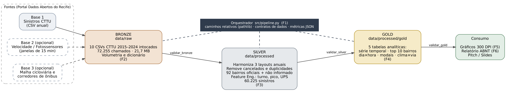

# DataRoute Recife 🚦

**Mobilidade Urbana, Sinistros de Trânsito e Transporte Metropolitano no Recife: Análise de Padrões Espaço-Temporais, Fluxo Viário e Gargalos Operacionais via Big Data**

Projeto Final da disciplina **Big Data** · Bacharelado em Sistemas de Informação, 6º período noturno
UNINASSAU, Unidade Recife/Olinda · Docente: Prof. Eduardo Hernandes · Entrega: 18/11/2026

---

## Problema

Os corredores arteriais do Recife (Av. Agamenon Magalhães, Mascarenhas de Morais, Abdias de Carvalho, Av. Recife e Caxangá) concentram os sinistros de trânsito registrados pela CTTU. Motociclistas, pedestres e ciclistas são a maior parte das vítimas. O projeto processa dados abertos da Prefeitura para identificar **onde, quando e em que condições** os sinistros são mais graves, como apoio à fiscalização preventiva e à política de segurança viária.

## Fontes de dados

| Base | Origem | Situação no pipeline |
|---|---|---|
| **Chamados de sinistros de trânsito com e sem vítimas, 2015–2024** (10 CSVs anuais) | CTTU · [Portal de Dados Abertos do Recife](https://dados.recife.pe.gov.br/dataset/acidentes-de-transito-com-e-sem-vitimas) · licença ODbL | ✅ Processada (Bronze → Silver → Gold) |
| Velocidade das vias / fotossensores (janelas de 15 min) | CTTU | Opcional |
| Malha cicloviária e corredores de ônibus | CTTU / Grande Recife | Opcional |

Os CSVs originais estão versionados em `data/raw/`, cópias byte a byte do portal. O link de cada arquivo está em `src/bronze.py` (`FONTES`).

### Números da execução oficial

| | Bronze | Silver |
|---|---:|---:|
| Registros | 72.255 chamados | 60.225 sinistros |
| Colunas | 45 (3 layouts anuais) | 27 (contrato) |
| Bairros | 126 grafias | 92 dos 94 oficiais + "não informado" |

Os achados da base real (layouts que mudam, vírgula decimal, chamados cancelados, efeito do Bate-Pronto em 2020 etc.) estão em [`docs/AUDITORIA_DADOS.md`](docs/AUDITORIA_DADOS.md). **Leitura obrigatória antes de analisar.**

## Arquitetura: Medalhão Adaptada



| Camada | Pasta | O que contém | Responsável |
|---|---|---|---|
| **Bronze** | `data/raw/` | CSVs originais, intocados | F2 |
| **Silver** | `data/processed/` | `sinistros_silver.csv`: base unificada, limpa e enriquecida | F3 |
| **Gold** | `data/processed/gold/` | 5 tabelas analíticas, uma por objetivo/gráfico | F4 |
| Consumo | `docs/figuras/` | Gráficos 300 DPI, relatório e slides | F5 / F6 |

O orquestrador `src/pipeline.py` (F1) executa as camadas em ordem e valida o **contrato de dados** de cada uma (`src/contratos.py`). Se uma camada entregar algo fora do padrão, o pipeline para. Ao final, grava `docs/metricas_pipeline.json` com a volumetria e as métricas de limpeza.

## Como executar

### Local
```bash
git clone https://github.com/pcsdv0/dataroute-recife.git
cd dataroute-recife
python -m venv .venv && source .venv/bin/activate   # Windows: .venv\Scripts\activate
pip install -r requirements.txt
python -m src.pipeline
```

### Google Colab

Clique no notebook da sua função. A primeira célula clona o repositório, instala as dependências e roda o pipeline sozinha:

| Notebook | Função | Abrir |
|---|---|---|
| `01_ingestao_bronze.ipynb` | F2 | [](https://colab.research.google.com/github/pcsdv0/dataroute-recife/blob/main/notebooks/01_ingestao_bronze.ipynb) |
| `02_limpeza_silver.ipynb` | F3 | [](https://colab.research.google.com/github/pcsdv0/dataroute-recife/blob/main/notebooks/02_limpeza_silver.ipynb) |
| `03_eda_gold.ipynb` | F4 | [](https://colab.research.google.com/github/pcsdv0/dataroute-recife/blob/main/notebooks/03_eda_gold.ipynb) |
| `04_dataviz.ipynb` | F5 | [](https://colab.research.google.com/github/pcsdv0/dataroute-recife/blob/main/notebooks/04_dataviz.ipynb) |

Ou, numa célula do Colab:
```python
!git clone https://github.com/pcsdv0/dataroute-recife.git
%cd dataroute-recife
!pip install -q -r requirements.txt
!python -m src.pipeline
```

Para executar só até uma camada: `python -m src.pipeline --ate silver`.

## Estrutura do repositório

```
dataroute-recife/
├── data/
│   ├── raw/                 # Bronze: 10 CSVs originais da CTTU (F2)
│   └── processed/           # Silver: sinistros_silver.csv, gerado pelo pipeline (F3)
│       └── gold/            # Gold: 5 tabelas analíticas (F4)
├── notebooks/
│   ├── 01_ingestao_bronze.ipynb   # F2
│   ├── 02_limpeza_silver.ipynb    # F3
│   ├── 03_eda_gold.ipynb          # F4
│   └── 04_dataviz.ipynb           # F5
├── src/
│   ├── config.py            # caminhos relativos (pathlib) e padrões
│   ├── utils.py             # leitura robusta UTF-8/Latin-1, normalização
│   ├── contratos.py         # contratos de dados entre camadas
│   ├── bronze.py · silver.py · gold.py
│   └── pipeline.py          # orquestrador (F1)
├── docs/
│   ├── figuras/             # diagrama da arquitetura + gráficos 300 DPI (F5)
│   ├── AUDITORIA_DADOS.md   # achados da base real e quadro Antes vs. Depois
│   └── metricas_pipeline.json  # métricas da última execução
├── CONTRIBUTING.md          # regras do pipeline
├── requirements.txt
└── README.md
```

## Stack

Python 3.10+ (testado em 3.13 e no pandas 2.2 do Colab) · Pandas · NumPy · PySpark (opcional) · Matplotlib · Seaborn · Plotly · Google Colab · Git/GitHub

## Licença dos dados

Dados: Prefeitura do Recife / CTTU, sob a Open Data Commons Open Database License (ODbL). Código: uso acadêmico.

## Equipe

| Função | Integrante |
|---|---|
| F1 · Coordenador do Projeto & Arquiteto de Big Data (Tech Lead) | Paulo César Santos de Vasconcelos |
| F2 · Engenheiro de Dados I (Coleta e Ingestão, Bronze) | Bruno Vinicius |
| F3 · Engenheiro de Dados II (Limpeza, ETL e Feature Engineering, Silver) | Wagner |
| F4 · Cientista/Analista de Dados (EDA e Estatística, Gold) | Lucy |
| F5 · Especialista em Visualização de Dados & Storytelling | Thomas |
| F6 · Redator Técnico, Auditor ABNT & PM | Douglas |
